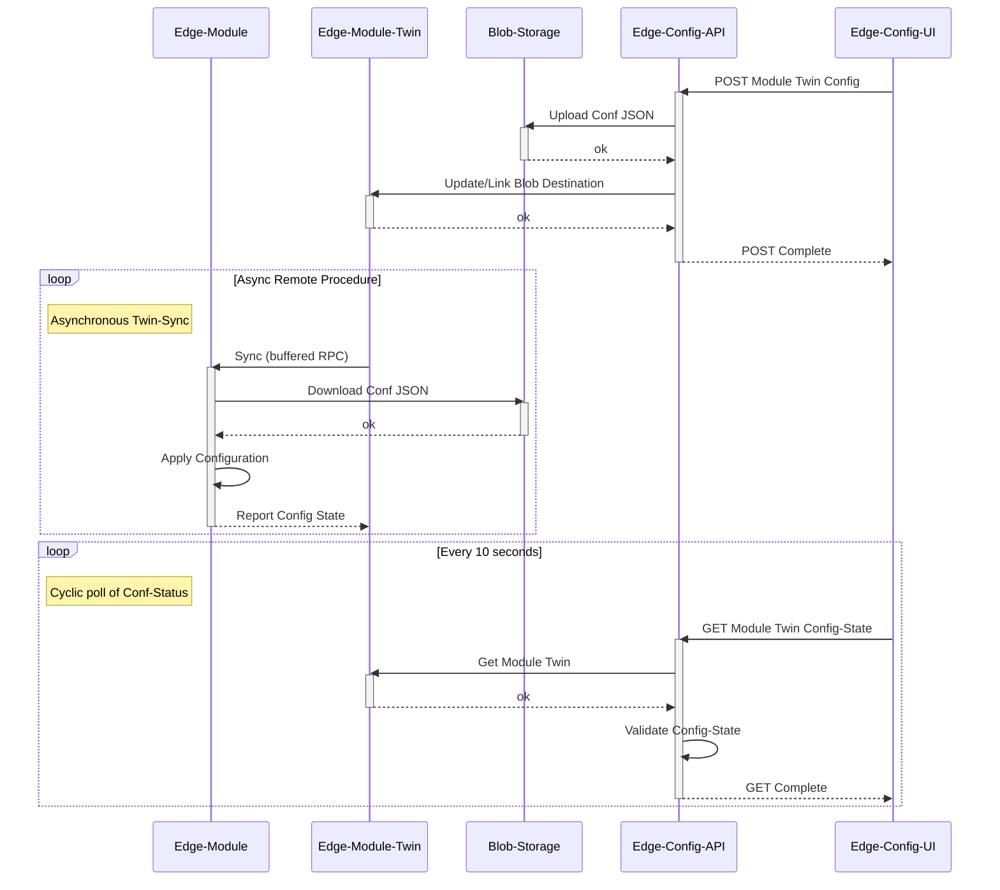

# Architecture

## System overview

The API manages IoT Edge module configurations using two Azure services:
1. **Azure Blob Storage** holds the actual config files — module twins are capped at 32 KB ([IoTHub quotas](https://learn.microsoft.com/en-us/azure/iot-hub/iot-hub-devguide-quotas-throttling)), so large configs are stored in Blob and only a reference is kept in the twin.
2. **IoT Hub module twins** carry a pre-signed blob URL and a `configId` in their `desired` properties, triggering the edge device to download the updated config asynchronously.

## Config flow



## Module twin data model

Only the IoTHub backend may write `desired`; only the edge module may write `reported`.

```json
{
  "properties": {
    "desired": {
      "configBlobUrl": "<pre-signed https blob link>",
      "configId": "<uuid4>"
    },
    "reported": {
      "configId": "<uuid4>",
      "config": {
        "status": true,
        "message": "config status message"
      }
    }
  }
}
```

## Config status

The API derives `confStatus` by comparing `desired.configId` and `reported.configId`:
| Condition | Status |
|---|---|
| `desired` is `null` / missing | `NO_CONFIG` |
| `desired` == `reported` | `OK` |
| `desired` != `reported` | `PENDING` |
| `reported` is `null` / missing | `INITIAL_PENDING` |
`appStatus` maps `reported.config.status` to `OK` / `ERROR` / `NO_STATUS`.

## Module configuration templates and revisions

All writers of a module configuration share `routers/module_config/service.write_module_config`:
upload the immutable blob `{device}/{module}/{configId}`, patch `desired` with `configBlobUrl` + `configId`
(the device contract above is unchanged), then append a row to `module_config_revisions`
(`source`: `template` | `raw` | `legacy-api` | `extension:<name>` | `reapply` | `external`, actor, comment,
template + values, content hash, parent revision). The blob is the revision's content.
A configuration written by other means (old clients, direct IoT Hub writes) is recorded as an
`external` revision the next time the history is read.

Templates (`module_config_templates`, `module_config_template_versions`) are immutable versions (the variable declarations are stored per version in `module_config_template_versions.variables`, JSONB; the slot declarations in `module_config_template_versions.slots`, JSONB, a list of `{name, endpoint_types, service_types}` that restricts which endpoint and service types may be chosen for an endpoint slot, empty or missing meaning any type):
every edit inserts the next version (read-only history; devices always render the latest), *duplicate* copies a version into a new template with lineage,
*archive* hides it.

Every template belongs to exactly one **namespace** (`module_config_namespaces`, e.g. "Business Unit XYZ - OPC UA").
A namespace holds the `module_names` (exact module names, no wildcards) its templates apply to and, optionally, **scopes**
(`module_config_namespace_scopes`, the platform's ABAC scopes): a device may use the namespace's templates only if
its metadata matches one of the scopes. No scopes means available for every device. Render and apply refuse a
template whose namespace does not list the module (422) or whose scopes do not include the device (403).
Namespaces are managed with `module_config.template.write`; only empty ones can be deleted. The engine (`routers/module_config/templating.py`) is structural JSON:

| Syntax | Meaning |
|---|---|
| `${name}` | declared variable (`string`, `text` (multi-line input), `number`, `integer`, `boolean`, `enum`; `required`) |
| `${device.a.b}` | device metadata (`devices.device_data`) |
| `${endpoint.<field>}`, `${endpoint[<slot>].<field>}` | field of the endpoint chosen for the slot (`endpoints`, `$endpoints`) |
| `${service[<slot>].<field>}` | field of the service chosen for the slot (`services`, `$services`) |
| `${endpoint.<field>.<sub>}`, `${endpoint[<slot>].<field>.<sub>}` | sub-field of one row of the endpoint's list field; the row is chosen with `rows: {slot: {field: row id}}` (stored as `$rows`), optional when the field has exactly one row |
| `"${x}"` (whole string) | keeps the value's JSON type; an optional variable without value removes the key / list item |
| `$${` | literal `${` |

Errors are findings with a JSON pointer (`/values/<var>` for inputs). For modules with a typed legacy
schema (`seal-app-net-discover`, `seal-module-opcua-client`) the rendered config is validated against it.
A block is referenced as `{"$ref": "<block name>"}` (stored as `{"$ref": "<id>"}`, so renames never break it) and always means the block's latest version. `$secret` is reserved for a later version.
A list is written `{"$list": ["<block name>", …]}` (stored with block ids): the device user adds any number of named entries, each one of the listed blocks. The entries are sent as `lists: {"<list key>": [{"name", "block_id"}]}` on render/apply, the entries' values and endpoint slots are keyed `<list key>/<entry name>/<name>`, and apply stores the entries in the revision values under `$lists` (endpoint choices under `$endpoints`).

| Route | Action |
|---|---|
| `GET/POST /module-config-namespaces`, `GET/PATCH/DELETE /module-config-namespaces/{id}` (`?module=` filters the list) | `module_config.template.read` / `.write` |
| `GET /{device}/modules/{module}/config/templates` (templates available for this module on this device: module listed, device within the namespace's scopes) | `device.read` |
| `GET/POST /module-config-templates`, `GET/PATCH/DELETE /module-config-templates/{id}`, `…/versions[/{n\|latest}]`, `…/duplicate`, `POST …/lint`, `POST …/preview` (sample `device` metadata, or `device_id` + `namespace_id` to render with a real device's metadata) | `module_config.template.read` / `.write` (`device_id` also needs `device.read` for that device) |
| `GET /module-config-namespaces/{id}/example-devices[?q=]` (devices to preview with: readable by the caller **and** within the namespace's scopes) | `module_config.template.read` + `device.read` |
| `POST /{device}/modules/{module}/config/render` | `device.read` (dry run) |
| `POST /{device}/modules/{module}/config/apply` | `device.module_config.apply` |
| `GET /{device}/modules/{module}/config/revisions[/{id}]` | `device.read` |
| `POST /{device}/modules/{module}/config/revisions/{id}/reapply` | template revisions: `device.module_config.apply`, others: `device.module_twin_config.write` |
| `POST /{device}/twin/config/{module}` (raw JSON, any module) | `device.module_twin_config.write` |
| `GET /{device}/twin/reported/{module}` (complete reported twin properties, without `$metadata`) | `device.read` |

API response type:

```python
class ConfigStatus(BaseModel):
    desiredConfId:  Union[str, None]
    reportedConfId: Union[str, None]
    confStatus:     Literal["OK", "NO_CONFIG", "PENDING", "INITIAL_PENDING"]
    appStatus:      Literal["OK", "ERROR", "NO_STATUS"]
    appMessage:     Union[str, None]
```

## File fields

A field of type `file` on an endpoint, service or device type holds a certificate, private key or CRL (PEM, or a DER certificate that is stored as PEM; at most 64 KB). The value in the owner's data is only a reference object, `{"$file": "<id>", "name", "kind": "certificate"|"private-key"|"crl", "not_after": "<ISO 8601 UTC>"|null, "uploaded_at"}`; a normal save cannot set, change or clear it. Lists, search and the metadata value suggestions show the file name. The file is stored in `field_files`:

| Column | Meaning |
|---|---|
| `id` | the `$file` id, new on every upload |
| `owner_kind`, `owner_id`, `field` | owner (`endpoint`, `service`, `device`) and field key, unique together; no foreign key, so `delete_orphans()` removes rows after owners, types and references are deleted |
| `name`, `kind`, `subject`, `not_after`, `sha256` | metadata read from the file |
| `content` | the PEM text, always encrypted (deferred column) |
| `secret` | copied from the field definition at upload; later definition changes do not affect existing rows |
| `uploaded_by`, `uploaded_at` | user name and time of the upload |

Routes: `PUT` (raw body, `?name=`), `GET` and `DELETE` on `/endpoints/{id}/files/{field}`, `/services/{id}/files/{field}` (permissions `device.endpoint.write` / `.read`) and `/devices/{id}/files/{field}` (`device.metadata.write` / `device.read`). Content is encrypted with Fernet; `FILE_ENCRYPTION_KEY` holds one or more keys separated by commas (the first encrypts, all decrypt, so keys can be rotated) and is read on every call. Without it uploads answer 503. There is no re-encryption: an old key can only be dropped from the list after every file encrypted with it has been uploaded again, and losing the key makes the stored files unreadable. A file name with control characters or line breaks is refused (422). A `secret` file (a private key) can never be downloaded: `GET` answers 403, and a private key is accepted only by a `secret` field.

### Files in module configurations

A template placeholder that is exactly a file field (`"${endpoint.key}"`) renders the file's PEM text; anything else (part of a longer text) is a finding. A render loads only the files referenced as the whole value of a top-level field of the device, a chosen endpoint or a chosen service, and only if the stored file belongs to that owner and field; any other reference (nested in another value, or to a file of another owner) is the finding `missing-file`, and a file that cannot be decrypted is `unreadable-file`. A save refuses a value that holds a file reference anywhere inside it unless it equals the stored value. The delivered blob contains the plain text, because the module reads it. For every value that came from a `secret` file (the flag on the stored file row) the renderer records an entry, and apply stores the list on the revision in `module_config_revisions.secret_paths` (JSONB, `[]` for revisions without secrets, raw, external and older ones):

```json
{"path": "/clients/0/clientPrivateKey", "owner_kind": "endpoint", "owner_id": "…", "field": "key", "name": "client.key", "sha256": "…"}
```

- **Masking.** Every route that returns a configuration replaces the value at each secret path with `<secret: client.key #a1b2c3d4>` (file name and the first 8 characters of the sha256, so a comparison still shows a changed key): preview, render, revision detail and the module configuration reads (`GET /{device}/twin/config/{module}` and the two typed ones, masked with the revision of the current `configId`; no revision, no masking). `GET …/binary` masks its file when it is the JSON blob of a revision with secret paths.
- **Write order.** A write with secret paths records its revision before the twin points at the blob: upload, insert the revision, then patch the twin. A failed insert fails the request and leaves the twin as it was; a failed twin patch fails the request but keeps the revision (the hub may have applied the patch anyway, so reads stay masked; a revision nothing points to leaks nothing). If the config id was meanwhile recorded as `external`, that row is updated with the write's fields. Writes without secret paths keep the old order (upload, patch, then record; a lost revision is picked up as `external`).
- **Apply.** A rendered string that looks like a mask (from the template body or a value) is an error finding `secret-placeholder` at its pointer, so a mask is never delivered as a key.
- **Rollback.** Re-applying a revision writes its old content, but at its secret paths the content of the file of that owner and field as it is now, so a replaced key never comes back. If that file has been removed the re-apply answers 409 `The file 'client.key' (endpoint field 'key') has been removed`; if it cannot be decrypted (key missing or rotated out), 409 `The file 'client.key' (endpoint field 'key') cannot be read: check FILE_ENCRYPTION_KEY`. Revisions without secret paths are written byte for byte as before.
- **Write-back.** Raw writes (`POST /{device}/twin/config/{module}`), the typed legacy writes and extension `twin_write` go through `service.write_supplied_config`: a string that is exactly a mask of the current revision (at any path, so inserting an item above it does not break it) becomes the file's current content and a secret path of the new revision (same 409 if the file is gone); any other value is taken as the new value and is no longer masked. A string that fully matches `<secret: .+ #[0-9a-f]{8}>` (DOTALL) but matches no mask of the current revision answers 409 `The value at /x is a secret placeholder that cannot be restored`, so a mask is never delivered as a key. The typed writes still echo the request as sent.

Known limits: the delivered configuration in Azure storage contains keys in plain text; whoever can apply a template to a device can put that device's key into its configuration (the key never comes back to the browser); losing `FILE_ENCRYPTION_KEY` makes stored files unreadable, so they must be uploaded again.

## Deployment architecture

Devices are targeted by IoT Hub deployment conditions based on device-twin tags:

```json
{
  "deployment": "base",
  "description": "Service Kempten Uwe",
  "customer": "Test Customer",
  "geoLocation": "47.737315601756144,10.339716700209028"
}
```
The base deployment targets all devices via `tags.deployment='base'` and rolls out a standard container set.
